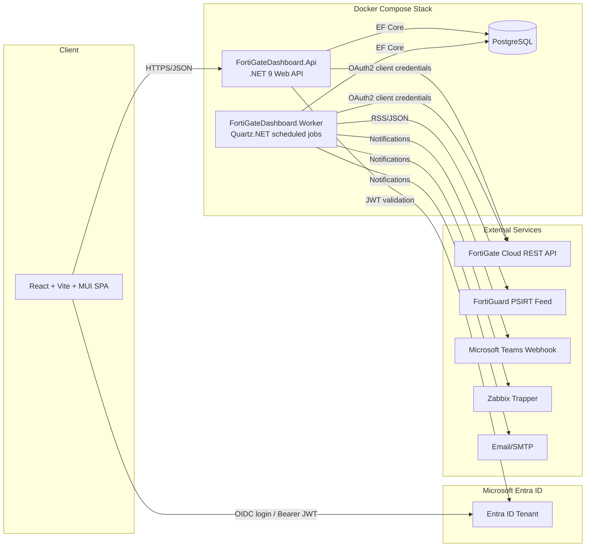
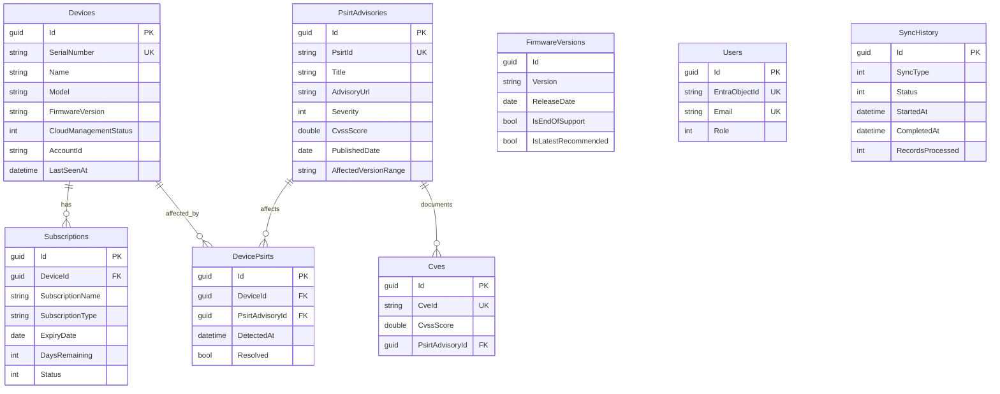

# FortiGate Cloud Asset Dashboard

A centralized inventory, subscription and PSIRT/vulnerability dashboard for MSPs managing large
FortiGate estates via FortiGate Cloud. Built with .NET 9, PostgreSQL, and a React + TypeScript +
Material UI frontend, designed to scale to 5,000+ devices.

## 1. Architecture



**Components**

| Component | Responsibility |
|---|---|
| `FortiGateDashboard.Core` | Domain entities, interfaces (`IFortiGateCloudService`, `IPsirtService`, `INotificationService`, `ISyncService`), DTOs, options |
| `FortiGateDashboard.Infrastructure` | EF Core `DbContext` + migrations, FortiGate Cloud OAuth client, PSIRT feed parser, notification channels (Zabbix/Teams/Email), `SyncService` orchestrator |
| `FortiGateDashboard.Api` | ASP.NET Core Web API, Swagger/OpenAPI, Entra ID JWT auth, Serilog, REST endpoints |
| `FortiGateDashboard.Worker` | Quartz.NET hosted service running the 6-hour device sync and daily subscription/PSIRT sync jobs |
| `frontend` | React + TypeScript + Vite + MUI SPA, MSAL-based Entra ID login, dashboard/device table/device detail pages |

## 2. Database Model



Migrations live in
[backend/src/FortiGateDashboard.Infrastructure/Data/Migrations](backend/src/FortiGateDashboard.Infrastructure/Data/Migrations).

## 3. API Design

Swagger UI is available at `/swagger` (enabled in `Development`/`Testing`). Key endpoints:

| Method | Route | Description |
|---|---|---|
| GET | `/api/devices` | Paginated, searchable, sortable, filterable device inventory |
| GET | `/api/devices/{serial}` | Device detail: basic info, subscriptions, vulnerabilities |
| GET | `/api/devices/export/csv` | CSV export of the device inventory |
| GET | `/api/dashboard` | Summary KPI cards |
| GET | `/api/subscriptions/expiring?withinDays=90` | Subscriptions expiring soon, soonest first |
| GET | `/api/psirt` | All known PSIRT advisories with affected device counts |
| POST | `/api/sync` | Triggers an on-demand full sync (Admin/Operator role) |
| GET | `/health` | Health check (DB connectivity) |

All endpoints (except `/health` and `/swagger`) require a valid Entra ID access token
(`Authorize: Bearer <token>`). Role-based policies: `Admin`, `Operator`, `Viewer` (see
`ApplicationUser.Role`; `/api/sync` requires `Admin` or `Operator`).

## 4. Security Notes

- FortiGate Cloud and SMTP credentials are **never** stored in source or plaintext config
  committed to git — `appsettings.json` only contains empty placeholders; real values are
  supplied via environment variables (see `.env.example` / `docker-compose.yml`) or a secret
  store (Azure Key Vault, Docker/Kubernetes secrets, `dotnet user-secrets` for local dev).
- Application authentication/authorization is delegated entirely to Microsoft Entra ID
  (`Microsoft.Identity.Web`); the API validates JWTs and never handles user passwords.
- FortiGate Cloud OAuth2 tokens are cached in memory only, refreshed automatically before
  expiry, and never persisted to disk or logs.
- CORS is restricted to the configured frontend origin(s).
- Known accepted risks: `xlsx` (SheetJS) has an upstream advisory with no fix release; the
  app only ever **writes** trusted, server-fetched data to `.xlsx` (never parses untrusted
  files), which is outside the vulnerable code path. `react-router-dom` v6's fix for an
  open-redirect edge case only shipped in v7; the app does not pass user-controlled input to
  `<Link>`/`navigate()`, mitigating the practical risk. Re-evaluate before an eventual v7 migration.
- **Rate limiting**: `/api/devices`, `/api/dashboard`, `/api/subscriptions`, `/api/psirt` use the
  `general` policy; `/api/devices/export/csv` uses the stricter `export` policy; `POST /api/sync`
  uses the strictest `sync` policy (1 request/minute per user by default). All are partitioned by
  the authenticated user's Entra ID object id (`oid` claim), falling back to remote IP for
  unauthenticated requests. Tune via the `RateLimiting` configuration section.
- **PSIRT correlation confidence**: every device/advisory correlation is now recorded with an
  explicit `CorrelationStatus` (`Affected` or `UnableToEvaluate`) — a PSIRT advisory or firmware
  string that cannot be confidently parsed is never silently treated as "not affected". See
  `PsirtAdvisory.ParseStatus` and `DevicePsirt.CorrelationStatus`.
- **FortiGate Cloud pagination is NOT implemented** — the real pagination contract (page/cursor/
  offset parameters) is not verified against vendor documentation or captured fixtures in this
  repository. `IFortiGateCloudService` returns a `CloudFetchResult<T>` with an
  `IsPossiblyTruncated` heuristic flag (record count crossing `FortiGateCloudResiliency:
  TruncationWarningThreshold`, default 1000); a possibly-truncated fetch marks the sync as
  `PartiallySucceeded`, never `Succeeded`. Treat this as an open item requiring a verified API
  contract before onboarding any single FortiGate Cloud account with more devices than that
  threshold.

## 5. Transport & TLS (Production Requirement)

**This application does not terminate TLS anywhere.** `docker-compose.yml` serves the API and
frontend over plain HTTP on the internal/host network. Before exposing this to real users or the
public internet, you MUST place an approved TLS-terminating reverse proxy, ingress controller, or
cloud load balancer in front of the `frontend` and `api` services (e.g. NGINX/Traefik/Envoy with a
CA-issued certificate, an Azure Application Gateway, or an equivalent). Do not substitute a
self-signed certificate for this requirement in production.

If your proxy sits in front of the API, you must also tell the API which proxy to trust so it can
correctly see the original client IP/scheme (used by rate-limit partitioning and `X-Forwarded-*`
handling). Set, per environment:

```json
"ForwardedHeaders": {
  "Enabled": true,
  "KnownProxies": ["10.0.0.5"],
  "KnownNetworks": ["10.0.0.0/24"]
}
```

Left at its default (`Enabled: false`), the API trusts nothing from `X-Forwarded-*` headers and
rate-limit partitioning falls back to the direct TCP peer address (which, without a correctly
configured proxy trust list, will be your proxy's own IP — meaning all traffic through an
unconfigured proxy shares one rate-limit partition. Configure this before relying on per-user
rate limiting in a proxied deployment).

`HSTS` is enabled automatically outside `Development`; it only affects browser behavior on
repeat visits and does not replace TLS termination itself.

## 6. Running Locally with Docker Compose

```bash
cp .env.example .env
# edit .env: set POSTGRES_PASSWORD, Azure AD app registration IDs, FortiGate Cloud credentials
docker compose up --build
```

`docker compose up` automatically merges `docker-compose.yml` (production-oriented baseline —
no Postgres port published, containers run with a read-only root filesystem, dropped Linux
capabilities, `no-new-privileges`) with `docker-compose.override.yml` (local-dev convenience:
republishes Postgres on `5432`, disables the read-only filesystem restriction). **For a real
deployment, run without the override:**

```bash
docker compose -f docker-compose.yml up -d --build
```

- Frontend: http://localhost:8081 (behind your own TLS-terminating proxy in production)
- API + Swagger: http://localhost:5000/swagger
- API health: http://localhost:5000/health
- PostgreSQL: internal network only in production; `localhost:5432` in local dev via the override

The API container runs EF Core migrations automatically on startup. Secrets (FortiGate Cloud
credentials, SMTP credentials, DB password) are supplied via `.env`/environment variables only —
never committed to source. For a real MSP deployment, replace the `.env` file mechanism with
Docker/Kubernetes secrets or a managed secret store (Azure Key Vault, etc.); this repository does
not yet wire up a secret-store configuration provider (see Remaining Limitations in the Phase 1
report).

**Backups**: the `postgres-data` named volume is the only persistent state. Back it up with your
standard Postgres backup tooling (`pg_dump`/volume snapshotting) on a schedule appropriate to your
sync frequency (device inventory changes at most every 6h; a daily backup is a reasonable floor).

## 7. Local Development (without Docker)

**Backend**

```bash
cd backend
dotnet user-secrets init --project src/FortiGateDashboard.Api
dotnet user-secrets set "ConnectionStrings:Default" "Host=localhost;Database=fortigate_dashboard;Username=fortigate;Password=changeme" --project src/FortiGateDashboard.Api
dotnet run --project src/FortiGateDashboard.Api
dotnet run --project src/FortiGateDashboard.Worker
```

**Frontend**

```bash
cd frontend
cp .env.example .env
npm install
npm run dev
```

**Local portal testing without Entra ID**

Developer mode is disabled by default and is available only when the API runs in the
`Development` environment with `Authentication:DeveloperModeEnabled=true`. The API accepts
only loopback callers and assigns a read-only `Viewer` identity; manual sync remains forbidden.
The frontend bypass is additionally restricted to Vite's development server and requires
`VITE_DEVELOPER_MODE=true`. Neither setting enables auth bypass in a production build or
Production ASP.NET environment.

In PowerShell, run the API from `backend`:

```powershell
$env:Authentication__DeveloperModeEnabled = 'true'
dotnet run --project src/FortiGateDashboard.Api --launch-profile http
```

Then run the frontend in a second terminal from `frontend`:

```powershell
$env:VITE_DEVELOPER_MODE = 'true'
$env:VITE_API_PROXY_TARGET = 'http://localhost:5228'
npm run dev
```

Open http://localhost:5173. The UI displays a Developer mode label. This bypass is intended
only for a local workstation; it is not enabled in Docker Compose and deliberately refuses
requests whose direct peer address is not loopback.

**Tests**

```bash
cd backend
dotnet test tests/FortiGateDashboard.UnitTests/FortiGateDashboard.UnitTests.csproj
dotnet test tests/FortiGateDashboard.IntegrationTests/FortiGateDashboard.IntegrationTests.csproj
```

```bash
cd frontend
npm run lint
npm run build
```

## 8. Microsoft Entra ID Setup

1. Register an **API app** (e.g. `fortigate-dashboard-api`), expose a scope `access_as_user`.
2. Register a **SPA app** (e.g. `fortigate-dashboard-spa`), add redirect URI
   `http://localhost:5173` (and your production frontend URL), grant delegated permission to
   the API app's `access_as_user` scope.
3. Assign app roles / security groups mapped to `Admin` / `Operator` / `Viewer` as needed;
   the API's `ApplicationUser.Role` table drives authorization policies.
4. Populate `AzureAd:*` (API), `VITE_AZURE_AD_*` (frontend), and `AZURE_AD_API_SCOPE`.
  Set `AZURE_AD_API_SCOPE` to the exact delegated scope shown under the API registration's
  **Expose an API** page (including its Application ID URI and scope name). For example,
  `api://<API-application-client-id>/access_as_user` is correct only if that exact URI is
  configured there. Do not derive this from the SPA client ID. The frontend image embeds this
  value at build time, so after changing it run `docker compose up -d --build frontend`.

## 9. Background Synchronization

The Worker service (`FortiGateDashboard.Worker`) uses Quartz.NET to run:

- **Every 6 hours** — `DeviceInventorySyncJob`: device inventory, firmware, cloud status.
- **Daily at 02:00** — `SubscriptionAndPsirtSyncJob`: subscription/license info and PSIRT
  advisories, followed by device/PSIRT correlation.

Every run is recorded in the `SyncHistory` table (status, record counts, errors). An on-demand
sync can also be triggered via `POST /api/sync`.

## 10. Notifications / Webhooks

Configured under `Notifications` in `appsettings.json` / environment variables. Each channel is
independently enabled/disabled:

- **Microsoft Teams** — adaptive card via incoming webhook (`Notifications:Teams:WebhookUrl`).
- **Zabbix** — JSON payload posted to a trapper HTTP endpoint (`Notifications:Zabbix:TrapperUrl`).
- **Email/SMTP** — plain-text alert email (`Notifications:Email:*`).
- **ServiceNow** — abstraction (`INotificationChannel`) is ready; add a
  `ServiceNowNotificationChannel` implementation and register it in
  `ServiceCollectionExtensions` when credentials/instance details are available.

Triggers: new critical PSIRT advisory, a subscription entering the "Critical" (<30 days) status,
and a device found running firmware affected by a critical CVE.

## 11. CI/CD

- [.github/workflows/ci.yml](.github/workflows/ci.yml) — builds/tests backend (unit +
  integration) and frontend (lint + build) on every push/PR, then builds all three Docker
  images to validate Dockerfiles.
- [.github/workflows/cd.yml](.github/workflows/cd.yml) — on version tags (`v*.*.*`), builds and
  pushes the API, Worker and Frontend images to GitHub Container Registry (GHCR).

## 12. Repository Layout

```
backend/
  src/FortiGateDashboard.Core/            # Entities, interfaces, DTOs, options
  src/FortiGateDashboard.Infrastructure/   # EF Core, FortiGate Cloud client, PSIRT client, notifications, sync
  src/FortiGateDashboard.Api/              # Web API, Swagger, auth, controllers
  src/FortiGateDashboard.Worker/           # Quartz.NET scheduled sync jobs
  tests/FortiGateDashboard.UnitTests/
  tests/FortiGateDashboard.IntegrationTests/
frontend/
  src/api/            # Axios client + typed endpoint wrappers
  src/auth/           # MSAL (Entra ID) configuration
  src/components/     # SummaryCards, DeviceTable (MUI DataGrid)
  src/pages/          # DashboardPage, DevicesPage, DeviceDetailPage, PsirtPage
  src/theme/          # Dark/light mode MUI theme provider
docker-compose.yml
.github/workflows/
```
